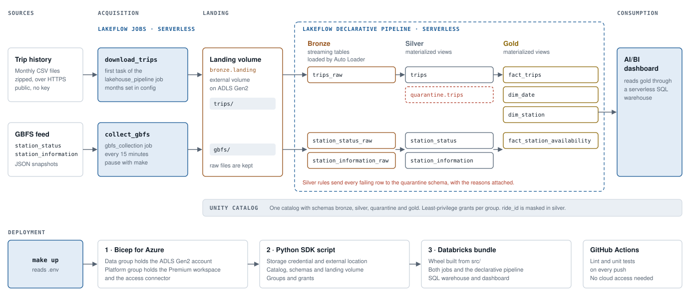

# Capital Bikeshare Analytics Lakehouse

An Azure Databricks lakehouse built on public Capital Bikeshare data. It covers
two questions:

- **Historical ridership.** How do people use the system over a three-month
  period? Which stations are busiest, and at what hours and on which days?
- **Observed station availability.** How often are stations seen with no bikes
  or no free docks, and at what times of day?

The two datasets cover different periods and are always reported separately.
The trip history covers April to June 2025. The station snapshots cover the
weeks in which the collector runs.

Everything is defined in code. One command builds the Azure resources, the
Unity Catalog objects, the jobs, the pipeline and the dashboard. Another
command removes them.



## Contents

- [Data sources](#data-sources)
- [Architecture](#architecture)
- [Bronze layer](#bronze-layer)
- [Silver layer](#silver-layer)
- [Gold layer](#gold-layer)
- [Data quality](#data-quality)
- [Governance](#governance)
- [Design decisions](#design-decisions)
- [Reproducing the project](#reproducing-the-project)
- [Repository layout](#repository-layout)
- [Limitations](#limitations)
- [Data licence](#data-licence)

## Data sources

| Source | What it holds | How it is collected |
|---|---|---|
| [Trip history](https://capitalbikeshare.com/system-data) | One row per completed trip: start and end time, start and end station, coordinates, bike type and rider type. Published monthly as zipped CSV files. | The `download_trips` job task downloads the configured months once each. |
| [GBFS](https://gbfs.capitalbikeshare.com/gbfs/gbfs.json) `station_status` | Bikes and docks available at every station at the moment the feed was last updated. | The `gbfs_collection` job stores one snapshot every 15 minutes. |
| [GBFS](https://gbfs.capitalbikeshare.com/gbfs/gbfs.json) `station_information` | Station name, short code, coordinates and capacity. | Collected with every status snapshot. |

The live feed only describes the present. A snapshot that is not collected is
lost for good, so the collector runs on a schedule in Databricks and its
files are kept in storage that teardown never deletes.

No source data is stored in this repository. The pipeline downloads it from
the official sources. See [Data licence](#data-licence).

## Architecture

| Layer | Tool | What it does |
|---|---|---|
| Acquisition | Lakeflow Jobs on serverless compute | Python tasks fetch trip files and GBFS snapshots over HTTPS and write them unchanged to a landing volume. |
| Landing | Unity Catalog external volume on ADLS Gen2 | Holds every raw file. The volume is external, so its files outlive the catalog. |
| Bronze | Streaming tables, Auto Loader | Loads each new file once. Records stay as published. |
| Silver | Materialized views | Types, validates and deduplicates records. Rejected rows go to the quarantine schema. |
| Gold | Materialized views | A star schema plus the aggregates the dashboard reads. |
| Consumption | AI/BI dashboard, serverless SQL warehouse | Two pages, one per dataset. |

Bronze, silver and gold run as one serverless Lakeflow Declarative Pipeline.
Auto Loader is the Lakeflow Connect standard connector for files. Bronze uses
streaming tables because a streaming table reads each file once, while a
materialized view would reread every file on each refresh. Silver and gold are
materialized views because they are recomputed from the layer below, and
Databricks refreshes them incrementally where it can.

The `lakehouse_pipeline` job runs these tasks every morning:

```
download_trips ──┐
                 ├──> refresh_pipeline ──> quality_checks
create_governance_functions ──┘
```

The transformation logic lives in `src/bikeshare_lakehouse` as plain PySpark
functions. The pipeline files in `src/pipelines` only wire those functions to
tables. The same functions are tested locally with pytest.

## Bronze layer

| Table | Grain | Notes |
|---|---|---|
| `bronze.trips_raw` | One row per CSV row | Every column kept as a string, so a malformed value cannot fail the load. Adds the source file path and ingestion time. |
| `bronze.station_status_raw` | One row per collected file | The whole JSON file stored as text, with the collection envelope. |
| `bronze.station_information_raw` | One row per collected file | Same as above. |

Auto Loader tracks which files it has processed. Running the pipeline again
with no new files adds no rows. Adding a fourth month loads only that month.

## Silver layer

Silver turns raw records into trustworthy ones. Each source is checked once.
Rows with no issues go to the silver table. Rows with issues go to a table of
the same name in the `quarantine` schema. The two always add up to bronze.

### `silver.trips`

One row per valid trip.

- **Types.** Text becomes timestamps, doubles and lowercase categories. Values
  that do not parse become null and are caught by the rules below.
- **Rejected trips.** A trip is quarantined only when it cannot be used at all:
  no `ride_id`, a timestamp that does not parse, an end before the start, or a
  repeated `ride_id`. For duplicates the first copy ingested is kept.
- **Kept and flagged.** About a quarter of trips have no start or end station.
  They are dockless e-bike trips. They still count toward ridership, so they
  stay in silver with `has_start_station = false`. Trips under
  60 seconds and over 24 hours are kept and flagged with `is_under_60s` and
  `is_over_24h`.
- **Derived columns.** Start date and hour, duration, round-trip flag and
  `trip_key`, a SHA-256 hash of `ride_id`.

### `silver.station_status`

One row per station per snapshot.

- Each file is expanded from one JSON document into one row per station.
- The grain is the station plus the feed's own `last_updated` time. If two
  polls arrive before the feed refreshes, they carry the same `last_updated`
  and the second copy is quarantined as a duplicate. Two snapshots with
  different times and identical counts are separate observations of a station
  that did not change, so both are kept.
- Negative counts, missing counts, unknown status flags and reports dated
  after the snapshot are quarantined.
- A report more than an hour older than its snapshot is kept and flagged with
  `is_stale`.
- Collection time and source time are stored separately. `collected_at` is
  when our job fetched the file. `snapshot_at` is when the operator says the
  data was updated.

### `silver.station_information`

One row per version of each station. Station details rarely change, and each
poll stores a fresh copy. Silver collapses identical copies into one version
with its first and last snapshot time. A renamed or moved station appears as a
second version. This tracks changes without a full slowly changing dimension.

## Gold layer

Gold is a star schema with two fact tables that share the station and date
dimensions.

| Table | Grain | Purpose |
|---|---|---|
| `dim_station` | One row per station code | Stations from the live feed plus stations that appear only in trip history. Two special rows stand for "no station" and "live station missing from the feed". |
| `dim_date` | One row per calendar day | Covers every day in either dataset. Monday is day 1. |
| `fact_trips` | One row per valid trip | Start and end station keys both point to `dim_station`, a role-playing dimension. |
| `fact_station_availability` | One row per station per snapshot | Counts converted to Washington DC local time, with `is_empty` and `is_full` flags. |
| `agg_daily_ridership` | Day, rider type, bike type | Trip counts and average duration. |
| `agg_hourly_station_demand` | Station, hour, weekday or weekend | Departures and arrivals, in total and per day. |
| `agg_station_availability` | Station | Observed empty and full rates. |
| `agg_availability_by_hour` | Hour, weekday or weekend | Observed empty and full rates across all stations. |

Why it is built this way:

- **Joining the two sources.** Trip files identify a station by a short code
  such as `31818`. The live feed uses a UUID and carries the short code as
  `short_name`. `dim_station` is keyed on the short code, so both facts join
  to it.
- **No lost trips.** Some stations in the 2025 trip history are no longer in
  the live feed. They are added to `dim_station` from the trip records, so
  every trip finds its station.
- **Stable keys.** Station keys are a hash of the station code. They stay the
  same when a materialized view is fully recomputed. A generated sequence
  would not.
- **No metric inflation.** `fact_trips` takes its station keys straight from
  the station code with no join, so its row count always equals
  `silver.trips`. Departures and arrivals are counted separately and joined on
  the same key, so a trip is never counted twice on one side. The quality
  checks confirm both after every run.
- **Local time.** Trip times are local Washington DC time. GBFS times are
  Unix epochs. Snapshots are converted to local time so that hours line up
  across the two facts.

## Data quality

Row-level rules run in silver, as described above. Every rejected row lands in
the `quarantine` schema with the original record as JSON, the list of failed
rules, the source file and the time it was quarantined. Nothing is dropped
without a record.

After each refresh the `quality_checks` task runs cross-table checks. Any
failure fails the job and sends the failure email.

- Every bronze trip is in silver or quarantine.
- `fact_trips` has the same row count as `silver.trips` and one row per trip.
- `dim_station` has one row per key.
- Every trip start station, end station and date exists in its dimension.
- `fact_station_availability` has one row per station and snapshot, and the
  same row count as `silver.station_status`.

The pipeline also records expectations on silver, which appear in the
pipeline's data quality view.

## Governance

All tables are registered in one Unity Catalog catalog with four schemas.
Access follows least privilege.

| Group | Access |
|---|---|
| `bikeshare_engineers` | Everything in the catalog. Sees `ride_id` unmasked. |
| `bikeshare_analysts` | Reads silver and gold. Sees `ride_id` as a hash. |
| `bikeshare_dashboard_viewers` | Reads gold only. |

Bronze and quarantine hold the original records, so only engineers can read
them. In silver, `ride_id` has a column mask. A ride identifier combined with
exact times and stations could help someone link a trip to a person, which the
data licence forbids. Analysts see the SHA-256 hash, which equals `trip_key`,
so joins and counts still work. Gold does not carry `ride_id` at all.

The deploying user is added to the engineers group. Unity Catalog records
lineage from the landing files through to the dashboard.

## Design decisions

- **Infrastructure tools.** The project has about ten resources. Bicep
  creates the Azure resources. It is Azure's own declarative format and needs
  no state file. The Databricks bundle deploys what runs. A short Python script
  creates the Unity Catalog objects, because the bundle cannot create a storage
  credential. Terraform was left out. It would add a state file to protect and
  a second language, and this project needs neither.
- **Two resource groups.** The storage account sits in its own resource group,
  which `make down` keeps. Collected GBFS snapshots cannot be fetched again, so
  removing them takes an explicit `CONFIRM_DATA_LOSS=yes`.
- **Serverless everywhere.** Jobs, pipeline and SQL warehouse all run on
  serverless compute. Nothing runs between jobs and there are no clusters to
  size.
- **A job collects the GBFS feed.** A scheduled job in Databricks keeps
  collecting when no laptop is on. Each run lasts a few seconds.
- **Raw text in bronze.** Bronze stores trip columns as strings and GBFS
  files as raw JSON. A malformed value then becomes a quarantined row in silver
  and never a failed load.
- **One environment.** This is a portfolio project, so there is a single
  deployment target. All names come from settings, so a second environment
  would only need a second `.env`.

[docs/engineering-notes.md](docs/engineering-notes.md) describes the problems
found in the real data and how each was handled.

## Reproducing the project

### Requirements

- An Azure subscription where you can create resource groups and role
  assignments. Owner on the subscription covers both.
- [Azure CLI](https://learn.microsoft.com/cli/azure/install-azure-cli),
  [Databricks CLI](https://docs.databricks.com/dev-tools/cli/install.html) and
  [GitHub CLI](https://cli.github.com/) (optional).
- Python 3.12 and Java 17. Java is used only by the local Spark tests.
- GNU Make.

### Settings

```bash
cp .env.example .env
```

Fill in `.env`. It is git-ignored and holds only values specific to you:

| Setting | Meaning |
|---|---|
| `AZURE_SUBSCRIPTION_ID` | Subscription to deploy into |
| `AZURE_LOCATION` | Azure region, for example `eastus` |
| `NAME_PREFIX` | Short lowercase prefix for resource names |
| `DATABRICKS_PROFILE` | Name of the Databricks CLI profile to create |
| `ALERT_EMAIL` | Address that receives job failure emails |

The project needs no passwords, tokens or keys. You sign in to each CLI
yourself, and Databricks reaches storage through a managed identity. If you
extend the project with a secret, keep it in `.env` and never commit it.

Shared settings such as the catalog name, trip months and poll interval are in
[`config/project.env`](config/project.env).

### Build and run

```bash
make setup      # virtual environment and development tools
make test       # unit and integration tests on local Spark
az login
make up         # Azure, Unity Catalog, bundle, first GBFS snapshot, first pipeline run
```

`make up` runs these steps in order. Each can also be run on its own.

| Step | What it does |
|---|---|
| `make preflight` | Checks the subscription and region and registers the resource providers |
| `make infra-up` | Shows the Bicep what-if result, then deploys the resource groups, storage account, workspace and access connector |
| `make databricks-login` | Opens the browser to sign in to the new workspace |
| `make catalog-up` | Creates the storage credential, external location, catalog, schemas, landing volume, groups and grants |
| `make deploy` | Builds the Python wheel and deploys the jobs, pipeline, SQL warehouse and dashboard |
| `make collect-now` | Collects one GBFS snapshot |
| `make run` | Runs `lakehouse_pipeline` once |

Other targets:

| Command | What it does |
|---|---|
| `make collect-pause` | Pauses the 15-minute GBFS schedule until the next plain `make deploy` |
| `make collect-resume` | Resumes it |
| `make lint` | Runs ruff |
| `make down` | Removes the bundle resources, the catalog and the platform resource group. Keeps the storage account and its files. |
| `make down CONFIRM_DATA_LOSS=yes` | Also deletes the storage account and every collected file |

After `make down`, a later `make up` recreates everything. The pipeline reloads
the landing files that were kept, including every GBFS snapshot collected so far.

### Cost

Trip data for three months is about 75 MB compressed. The GBFS job makes 96
short serverless runs a day, and the pipeline job runs once a day. Pause the
collector with `make collect-pause` when you do not need new snapshots.

## Repository layout

```
├── Makefile                  every build and run command
├── config/project.env        shared settings
├── .env.example              template for your own settings
├── infra/bicep/              Azure resources
├── scripts/                  Unity Catalog setup and teardown
├── databricks.yml            bundle definition
├── resources/                jobs, pipeline, warehouse and dashboard
├── src/bikeshare_lakehouse/  collectors, transformations, gold model, quality checks
├── src/pipelines/            pipeline definitions for bronze, silver and gold
├── dashboards/               AI/BI dashboard definition
├── tests/                    unit and integration tests
└── docs/                     architecture diagram, data model, licensing, engineering notes
```

## Limitations

- GBFS reports how many bikes and docks each station has. It does not report
  individual rentals or returns. Changes between snapshots can come from
  rebalancing, so the project does not infer trips from them.
- A 15-minute poll does not see every change. Empty and full rates are the
  share of snapshots in which a station was empty or full. They are not the
  share of time.
- The trip history and the station snapshots cover different periods and are
  never combined into one metric.
- This is a portfolio project run at small scale. It is not a 24/7 production
  platform.

## Data licence

The data is provided by Capital Bikeshare under the
[Capital Bikeshare Data License Agreement](https://capitalbikeshare.com/data-license-agreement).
This project downloads the data from the official sources and publishes only
code and analysis. It does not redistribute the data, does not attempt to
identify riders, and is not affiliated with or endorsed by Capital Bikeshare
or Lyft. See [docs/data-sources-and-licensing.md](docs/data-sources-and-licensing.md).

The code is released under the [MIT licence](LICENSE). That licence covers the
code only, never the data.
